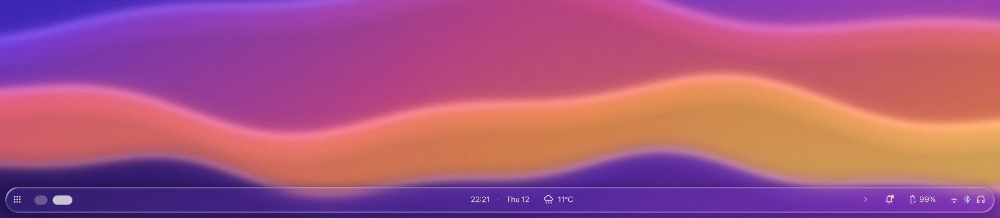
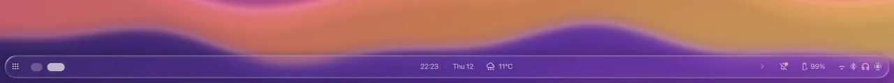
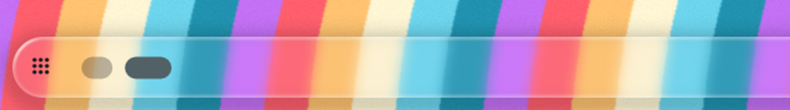
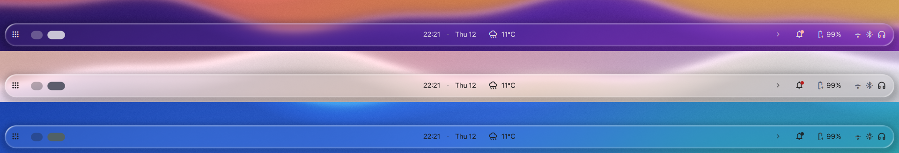
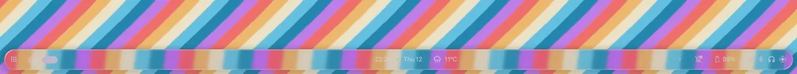

# ✨ Liquid Glass Bar

**Give your DankMaterialShell bar the macOS Tahoe "Liquid Glass" look.**



Your bar becomes a clear glass capsule floating just above the edge of the screen. Its curved edges bend and magnify the wallpaper behind it, light catches the rim and follows your pointer, and a soft shadow lifts it off the desktop. It's real refraction, not just blur.

## See it in action

**Follows your wallpaper, and keeps text readable on any of them**



**Edges that bend the light**: look how the stripes curve into the rim



**White text over dark wallpapers, dark text over light ones**



**The glass melts away and forms again when the bar hides and shows**


**Live video glass** (optional): with a video wallpaper, the glass moves along with it



## Why you'll like it

- 🫧 **Real glass, not just blur.** The edges bend the wallpaper like a thick pane of glass.
- 🌗 **Always readable.** Like the macOS menu bar, text and icons turn white over dark wallpapers and dark over light ones, in both light and dark mode.
- 🖼️ **Follows your wallpaper.** The glass picks up the wallpaper's colours, and updates instantly when you change the wallpaper or switch between light and dark mode.
- ✨ **Alive, but calm.** A soft light follows your pointer over the bar, and the glass forms and melts away when the bar shows or hides.
- 🎚️ **Make it yours.** Sliders for refraction, frost, highlights, tint, shadow and more.
- 🔋 **Battery friendly.** Nothing animates in the background. It only redraws when something changes or while you're pointing at the bar.

## Install

```sh
git clone https://github.com/hua0512/dms-liquid-glass-bar ~/.config/DankMaterialShell/plugins/liquidGlassBar
dms ipc call plugins enable liquidGlassBar
```

Then let the glass shine through:

1. Open **Settings → Bar → Appearance**, set the bar's **transparency to 0** and turn its **border off**.
2. For the floating Apple look, on the same page set **Edge spacing** to **8**, turn **Goth corners** off, and under **Widget style → Background** turn on **Override** and set the **Opacity** to **0**, so the widgets sit straight on the glass.
3. **On niri**, add this to `~/.config/niri/config.kdl`. The first rule turns off the compositor's own blur for the bar. The other two keep the glass still, together with the wallpaper, so it doesn't slide away when you switch workspaces or shrink into the overview (and fade back in late) when you open and close it:

   ```kdl
   layer-rule {
       match namespace="^dms:bar$"
       background-effect {
           blur false
       }
   }
   layer-rule {
       match namespace="^quickshell$"
       place-within-backdrop true
   }
   layer-rule {
       match namespace="^dms:liquid-glass$"
       place-within-backdrop true
   }
   ```

   Keep the last two rules together: with only the glass rule, the wallpaper would cover the glass.

That's it.

## Make it yours

Open **Settings → Plugins → Liquid Glass Bar** and adjust:

| Setting | What it does |
|---|---|
| **Frost** | Clear glass, or soft and milky |
| **Refraction** | How strongly the edges bend the wallpaper |
| **Edge lensing** | *Magnify* (like a lens) or *Wrap* (the edge curls in what's beyond it) |
| **Rim highlight** | How bright the light on the edge is |
| **Shape** | Rounded *capsule*, or follow your bar's own corners |
| **Saturation** | Colour boost of the wallpaper behind the glass |
| **Chromatic fringe** | A subtle rainbow at the very edge |
| **Tint colour / strength** | Tint the glass white, black or in your theme colours |
| **Legibility scrim** | A faint shade behind text over busy wallpapers |
| **Drop shadow** | Lift the bar off the desktop |
| **Wallpaper tint** | How much the glass picks up the wallpaper's colours |
| **Hover glow** | A soft light that follows your pointer over the bar |
| **Show/hide animation** | The glass forms and melts away when the bar shows or hides |
| **Adaptive text colour** | Turn off to keep your theme's text colour |
| **Live video glass** | With a video wallpaper, the glass moves along with the video. Off by default |
| **Live video frame rate** | How often the moving glass updates: 15, 24 or 30 times a second. Lower saves battery |

You can also change settings from a script or a keybind:

```sh
dms ipc call liquidGlass set frost 60
```

## Good to know

- **Requirements:** DankMaterialShell / Dux Shell **2.1 or newer** with a normal docked bar (island mode isn't supported). Made and tested on **niri**.
- **Only the wallpaper is bent.** A floating window behind the bar shows through clearly instead.
- **Video wallpapers** show a still frame in the glass, unless you turn on **Live video glass**. It needs **ffmpeg**: the first time you use a video, the plugin spends a few seconds preparing the strip behind the bar, and shows the still frame until that's done (or for good, without ffmpeg). After that it costs a little extra battery, a bit less at a lower frame rate. It pauses whenever DMS pauses its video or the bar is hidden. Shortly after the glass starts moving (and again now and then when DMS resumes the video), the plugin takes a few tiny screenshots of the wallpaper between the bar and the screen edge with **grim** to line the glass up with DMS's video, so the two usually stay within a couple of hundredths of a second. That needs grim and a small gap there (a floating bar); without them, the glass can be up to about a fifth of a second ahead or behind.
- **DMS updates may break it.** The plugin hooks into DMS's bar, so a major DMS update could break it. If that happens, the glass simply doesn't appear and nothing else breaks. Please [open an issue](https://github.com/hua0512/dms-liquid-glass-bar/issues).

## Turn it off

```sh
dms ipc call plugins disable liquidGlassBar
```

Then bring back your bar's transparency, border, edge spacing and widget background in **Settings → Bar → Appearance**.

<details>
<summary><b>How it works (for the curious)</b></summary>

A desktop shell can't see what's behind it, and niri can only blur. But a docked bar reserves its own strip of the screen, so the only thing behind it is your wallpaper.

So the plugin draws your wallpaper under the bar, lined up pixel for pixel, and runs it through a glass shader. The shader traces the bar's rounded outline and bends the image along the rim. It then adds a little colour dispersion, frost, a tint from the average wallpaper colour, a light ring on the rim and a shadow. Another small shader swaps the bar's text and icons to light or dark colours when the wallpaper calls for it.

The glass only redraws when something changes: briefly while the bar shows or hides, and at most about 30 times a second while the pointer moves over the bar.

**Live video glass** can't reach DMS's own video player, so it shows its own copy of the picture. ffmpeg cuts out just the strip the glass looks at (cropped the way DMS lays out the video, at the chosen frame rate) once per video and bar position, as one small JPEG per frame in `~/.cache/dms-liquid-glass-bar` (at most about 200 MB: the clips used least recently are removed first). The plugin keeps a clock of where DMS's player should be: it runs while DMS plays its video and stops when DMS pauses it (lock screen, screen off, fullscreen windows, niri's overview blur). The glass shows whichever frame that clock points at, so it never drifts from it. To set the clock right, ffmpeg also stores a tiny greyscale fingerprint of the video (up to 30 frames a second) in the gap between the bar and the screen edge; once per video, and again at most once a minute when DMS resumes it, about two seconds of screenshots of that gap are matched against the fingerprints near where the clock is, to see which frame DMS really shows. Everything is unloaded 20 seconds after the video pauses. While it plays, the glass redraws only when the frame changes, and the text-colour check runs on a small snapshot every few seconds.

**Editing the shaders:** the compiled `.qsb` files are included. After editing a `.frag`, rebuild it with:

```sh
/usr/lib/qt6/bin/qsb --glsl "100 es,120,150" --hlsl 50 --msl 12 -o shaders/liquid_glass.frag.qsb shaders/liquid_glass.frag
```

Then bump the `?v=` number in `LiquidGlassDaemon.qml` (Qt caches shaders), or run `dms restart`.

</details>

## License

[MIT](LICENSE)
